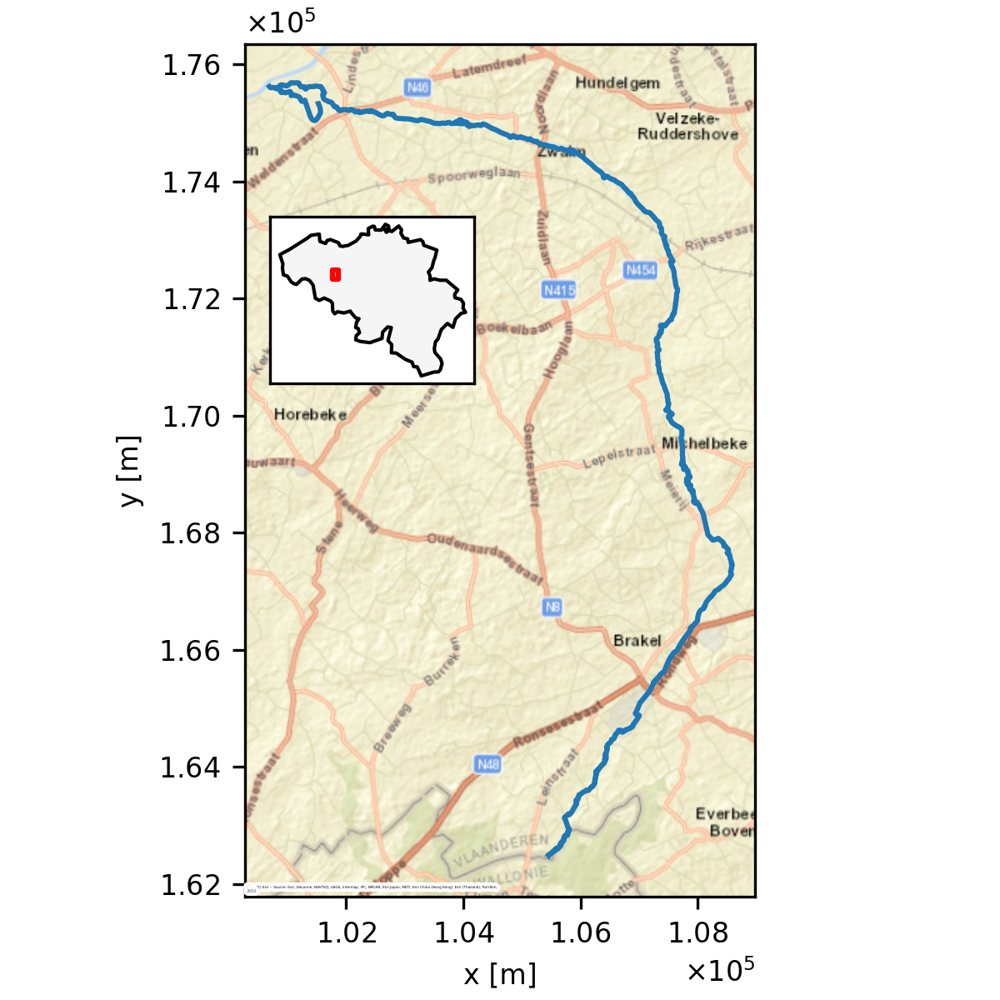
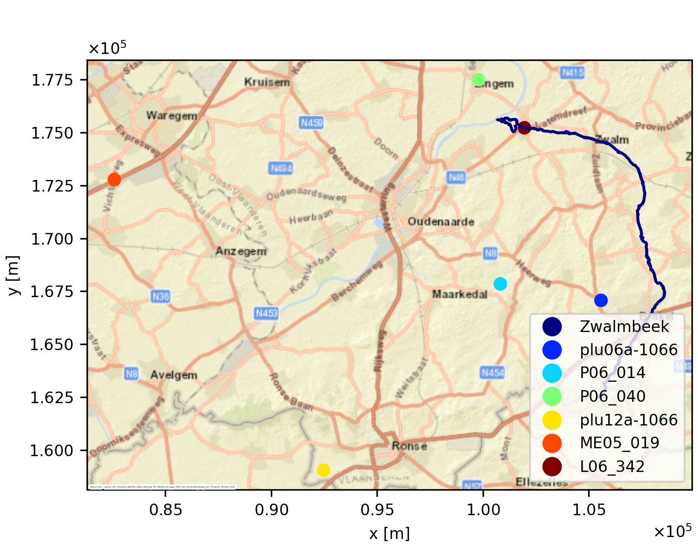
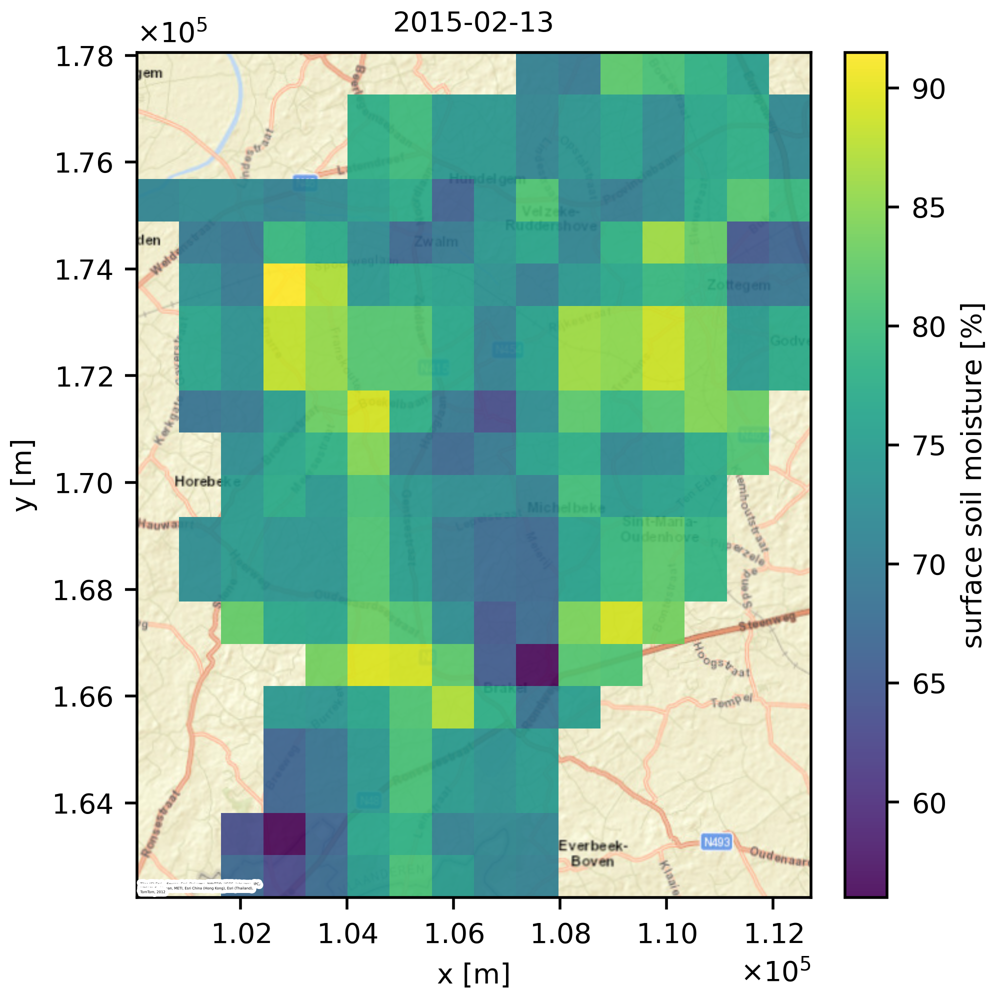

# Study area and data {#sec-study-area}

```{python}
# | echo: false
# | output: false
# Geospatial figures are pre-generated by scripts/data_process/study_area_figures_process.py
import pandas as pd
from pprint import pprint
from scripts.data_process.conf import (
    DTM_SPATIAL_RESOLUTION_UPSCALED,
    FILENAME_FORCINGS_DISCHARGE,
    FILENAME_FORCINGS_DISCHARGE_META,
    FILENAME_SATELLITE_SOIL_MOISTURE,
    FORCINGS_DISCHARGE_PROCESSED_DIR,
    SATELLITE_SOIL_MOISTURE_PROCESSED_DIR,
    WINDOW_SIZE_CLIMATOLOGY,
)
```

```{python}
# | echo: false
# | output: false
# summary statistics Zwalm catchment
df_fd = pd.read_csv(
    FORCINGS_DISCHARGE_PROCESSED_DIR / FILENAME_FORCINGS_DISCHARGE,
    index_col=0,
    parse_dates=True,
)
yearly_sums = df_fd.groupby(df_fd.index.year).sum()
yearly_mean = yearly_sums.mean()
start_year = int(df_fd.index.year.min())
end_year = int(df_fd.index.year.max())
```

For these exercises, a hydrological dataset of the Zwalm catchment will be used. The Zwalm catchment is located in the centre of Belgium and can be considered a medium-scale catchment. Its main tributary, the Zwalmbeek, is visualised in @fig-zwalmbeek. During the period `{python} start_year`-`{python} end_year`, a dataset of daily precipitation, potential evapotranspiration and discharge is at your disposal (see @sec-study-area-forcings-discharge for more information). The average annual rainfall and potential evapotranspiration of the catchment are `{python} f"{yearly_mean.precipitation:.0f}"` mm and `{python} f"{yearly_mean.potential_evapotranspiration:.0f}"` mm respectively, typical values for Belgium.

{#fig-zwalmbeek}

As mentioned in @sec-practical-info, all the processed data is available at `data/processed`. If interested, you can inspect all downloading and processing steps yourself by following the instructions in `scripts/data_download/README.md` and `scripts/data_process/README.md` of the repository. 

::: {.callout-important icon="false" title="Challenge"}

If interested, you can run this geospatial processing code yourself. Note that however that you need to install the developer environment in `environment_dev.yml` and activate it with `conda activate hydromod_env_dev`.
:::


In the next section, more information is given on the data sources and processing steps for the different types of provided data. Note that all geographic data is provided in the [Belgian Lambert 72](https://epsg.io/31370) (BD72, EPSG:31370) coordinate reference system (CRS).

## Catchment data {#sec-study-area-catchment-data}

The data in the `data/processed/catchment_info` folder contains information on the river network and the catchment boundaries in the broad vicinity of the Zwalm catchment. The source of the river network is the *Vlaamse Hydrografische Atlas* [@vmm2026]. The catchment boundaries come from the *Oppervlaktewaterlichamen en hun afstroomgebieden, 2022-2027* dataset [@vmm2022]. In @sec-delineation, you will be asked to delineate the catchment boundary of the Zwalmbeek yourself. The provided catchment boundaries can be used for comparison. Both files are provided as ESRI Shapefiles, called `afstroomgebied.shp` and `vlaamse_hydrografische_atlas.shp` respectively.

## Digital terrain model {#sec-study-area-dtm}

For the catchment delineation of @sec-delineation, a digital terrain model (DTM) is provided in `data/processed/digital_terrain_model`. This DTM is derived from the *Digitaal Hoogtemodel Vlaanderen II* DTM at 1m spatial resolution [@adv2014]. To reduce the size of the dataset and speed up the computation, the DTM has been resampled to a spatial resolution of `{python} DTM_SPATIAL_RESOLUTION_UPSCALED` m by averaging. The DTM is provided as a GeoTIFF file, called `DHMVII_DTM_1m_upscaled_10m.tif`.

## Meteorological and discharge data {#sec-study-area-forcings-discharge}

Both meteorological forcings and observed discharge are provided in the folder `data/processed/forcings_discharge`. All this data is retrieved from [Waterinfo](https://waterinfo.vlaanderen.be/), a website which combines hydro(meteorological) data from both the Flanders Environment Agency and Flanders Hydraulics Research. Programmatic access to the data is possible via the Python package [`pywaterinfo`](https://fluves.github.io/pywaterinfo/#), as demonstrated (for your information only) in `scripts/data_download/waterinfo_download.py`.

The combined forcings and discharge dataset is provided in the CSV file `forcings_discharge.csv`. An overview of the the original data sources is given in @tbl-waterinfo-meta. Note that mm is equivalent to mm/d because of the daily time resolution. The locations of the different measurement stations are additionally shown in @fig-waterinfo-sites. Some processing details:

- Precipitation ($P$) is the areal average of four rain gauges (Elst, Maarke-Kerkem, Zingem and Ronse) using Thiessen polygons as weighting factors^[See the [Hydrology course in the Bachelor](https://studiekiezer.ugent.be/studiefiche/nl/I003109/2026) for more information on this technique], clipped to the Zwalm catchment as delineated by the Flemish government. When a gauge has no data for a given day, the Thiessen weights are recomputed with the remaining gauges. The Thiessen weights for each gauge when all gauges are available, are given in @tbl-waterinfo-meta.
- Potential evapotranspiration ($E_\mathrm{p}$) is estimated using the Penman equation at a meteorological station. Missing values are gapfilled with the daily, smoothed climatology of $E_\mathrm{p}$. Smoothing occurs by applying a moving average with a centred window of `{python} WINDOW_SIZE_CLIMATOLOGY` days. 
- River discharge ($Q$) is measured near the mouth of the Zwalmbeek in the village of Nederzwalm. No gapfilling is applied to this variable, as it is only used for model evaluation, not as a model input.

```{python}
# | label: tbl-waterinfo-meta
# | output: asis
# | tbl-cap: "Metadata of the provided daily forcings and discharge dataset, retrieved from Waterinfo. Each variable has a corresponding measurement station, denoted by a unique station ID."
df_meta = pd.read_csv(
    FORCINGS_DISCHARGE_PROCESSED_DIR / FILENAME_FORCINGS_DISCHARGE_META,
    index_col=0,
)
df_meta.reset_index(inplace=True, names="Variable")
df_table = df_meta[["Variable", "unit", "name", "id", "thiessen_weight"]].rename(
    columns={
        "name": "Station",
        "id": "Station ID",
        "unit": "Units",
        "thiessen_weight": "Thiessen weight",
    }
)
df_table["Thiessen weight"] = df_table["Thiessen weight"].map(
    lambda w: "" if pd.isna(w) else f"{w:.2f}"
)
print(df_table.to_markdown(index=False))
```

{#fig-waterinfo-sites}


Consequently, following columns are present in `forcings_discharge.csv`: 

```{python}
df_fd = pd.read_csv(
    FORCINGS_DISCHARGE_PROCESSED_DIR / FILENAME_FORCINGS_DISCHARGE,
    index_col=0,
    parse_dates=True,
    nrows=2,
)
column_names = ["", *df_fd.columns]
pprint(column_names)
```

Note that the first column without a name is the index column, which contains the date. The column `precipitation_vmm_catchment` is an alternative catchment precipitation product of the Flanders Environment Agency (Precipitation of catchment in @tbl-waterinfo-meta), gapfilled with the Maarke-Kerkem gauge. It is only provided for comparison, for what follows use `precipitation`. 

The correct interpretation of the date is that the data value corresponds to the daily sum ($P$ and $E_\mathrm{p}$) or daily mean ($Q$) of the day indicated by the date. For example, the value of $P$ on 2020-01-01 corresponds to the total precipitation that fell during that day.

::: {.callout-tip}
To read in `forcings_discharge.csv`, checkout the documentation for [`pandas.read_csv()`](https://pandas.pydata.org/docs/reference/api/pandas.read_csv.html), specifically of the `index_col` and `parse_dates` parameters, to correctly read in the dataset.

:::

## Satellite soil moisture {#sec-study-area-ssm}

In @sec-assimilation, the goal is to improve the hydrological model predictions by assimilating observations of soil moisture. Here, we'll use satellite-derived surface soil moisture ($SSM$), which is provided in the folder `data/processed/satellite_soil_moisture`. 

The original data source is the SSM product at 1 km spatial resolution over Europe from the [Copernicus Land Monitoring Service](https://land.copernicus.eu/en) [@clms2026]. An example of the original data for one example date is shown in @fig-ssm-original. The $SSM$ values are expressed in percent saturation and are representative of the top few centimetres (~5cm) of the soil. 

{#fig-ssm-original}

For ease of use, the dataset has been processed to a timeseries by taking the average $SSM$ value over the Zwalm catchment and subsequently removing outliers. The resulting final timeseries is called `satellite_soil_moisture.csv`, which has following columns:

```{python}
df_ssm = pd.read_csv(
    SATELLITE_SOIL_MOISTURE_PROCESSED_DIR / FILENAME_SATELLITE_SOIL_MOISTURE,
    parse_dates=True,
)
print(list(df_ssm.columns))
```

with `time` the date of acquisition, `ssm` the spatially averaged $SSM$ and `noise` is the spatially averaged standard deviation of the $SSM$ following  a simple mean^[Alternatively, one could follow the [rules of propagation of uncertainty](https://en.wikipedia.org/wiki/Propagation_of_uncertainty). In that case, any function $f$, the standard deviation is given by $\sigma_{f}={\sqrt {\left({\frac {\partial f}{\partial x}}\right)^{2}\sigma_{x}^{2}+\left({\frac {\partial f}{\partial y}}\right)^{2}\sigma_{y}^{2}+\left({\frac {\partial f}{\partial z}}\right)^{2}\sigma_{z}^{2}+\cdots }}$ assuming **no covariance** between $x,y,z\cdots$ and linearly approximating $f$. Note that an average is a linear function, so here this is not an approximation. With the average $\bar{x} = \frac{1}{N} \sum_{i=1}^N x_i$ as $f$, $\frac{\partial f}{\partial x_i} = \frac1N$ and so $\sigma^2_{\bar{x}} =\sum_{i=1}^N \left(\frac{\partial \bar{x}}{\partial x_i} \right)^2\sigma_i^2  = \frac{1}{N^2} \sum_{i=1}^N \sigma_i^2$. This assumption of no covariance is a strong one however, which does not necessarily hold up for soil moisture retrievals which exhibit spatial correlation. Therefore, we make the safe assumption of perfectly correlated pixels, which increases the estimated uncertainty to $\sigma_{\bar{x}}^2 = \frac{1}{N} \sum_{i=1}^N \sigma_i^2$].
